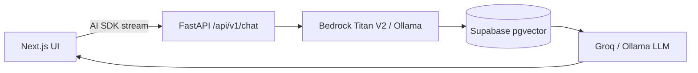

# DIGEMID RAG

Cited RAG assistant for Peruvian OTC pharmaceutical documentation (DIGEMID). Retrieves excerpts from Supabase `pgvector`, streams grounded answers, and links every claim to its source PDF and page.

> For document consultation only—not a substitute for medical, pharmaceutical, or regulatory advice.

## Architecture



## Quick Links

| Path | Description |
| --- | --- |
| [apps/frontend](apps/frontend/README.md) | Next.js chat workspace & citation viewer |
| [apps/backend](apps/backend/README.md) | FastAPI API, retrieval pipeline, env reference & ingestion scripts |
| [apps/backend/migrations](apps/backend/migrations) | SQL schema migrations (`pgvector` `1024`-dim) |
| [.env.example](.env.example) | Root environment template |

## Quickstart

1. **Configure env**
   ```bash
   cp .env.example .env
   ```
   Set `SUPABASE_DB_URL`, `GROQ_API_KEY` (when `CHAT_PROVIDER=groq`), and AWS credentials (`AWS_PROFILE` locally or an IAM role in production) for `EMBEDDING_PROVIDER=bedrock`.

   For the frontend, create `apps/frontend/.env.local`:
   ```env
   BACKEND_API_URL=http://127.0.0.1:8000
   ```

2. **Run backend**
   ```bash
   cd apps/backend
   uv sync --frozen
   uv run uvicorn app.main:app --reload
   ```

3. **Run frontend**
   ```bash
   cd apps/frontend
   pnpm install --frozen-lockfile
   pnpm dev
   ```

   Open <http://localhost:3000>.

4. **Docker (optional)**
   ```bash
   docker compose up --build app
   # With NVIDIA GPU (Ollama):
   docker compose -f docker-compose.yml -f docker-compose.gpu.yml up --build app
   ```

## Verify

```bash
cd apps/backend && uv run pytest -q
cd ../frontend && pnpm lint && pnpm build
```
